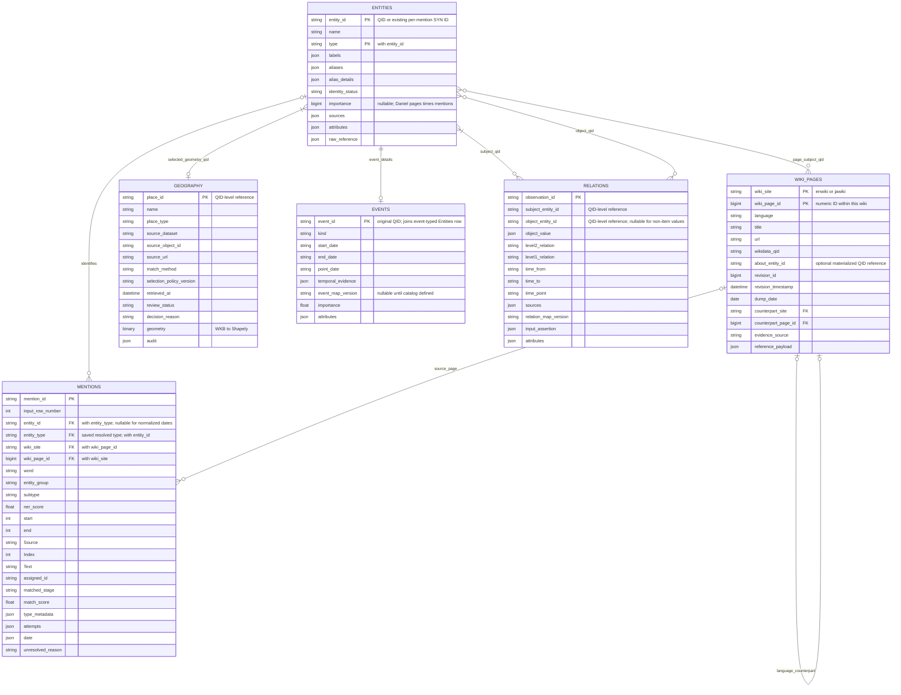

# Entity data model and ERD

Status: agreed six-table design with explicit implementation exceptions, 19 October 2026. This document does not change matching assignments, build tables, or rebuild the graph.

The separate [sources-to-model population S2T](SOURCES_TO_ENTITY_DATA_MODEL_S2T.md) defines approved inputs and population rules. It uses Wikidata assertions and events, including native event hierarchy root Q140451665 and the two-distinct-Daniel-entity inclusion rule. WarSampo and EventKG facts are outside this population scope.

Export decisions confirmed on 19 October 2026 are defined in [the Agent graph S2T](ENTITY_MODEL_TO_AGENT_GRAPH_S2T.md). Sources and paragraph text are omitted from this export. No paragraph object or paragraph-level text processing is added. Legacy `Text` and `Index` input fields below describe the original input contract; this documentation change does not delete or rewrite that input.

Six business tables: **Entities, Mentions, Wiki Pages, Geography, Events, Relations**. Versioned mapping catalogs and immutable evidence files remain supporting artifacts. JSON fields below are structured, retained data, not discarded columns.

Type decision, 19 October 2026: distinct `(entity_id, type)` combinations are entirely separate entities. No canonical entity or winner is selected. Relations remains at QID level. Approved graph IDs are `QID::type`, with the original QID retained in `wikidata_id`; the Agent resolves QID endpoints to the separate typed entities without copying assertions. Synthetic IDs remain unchanged. Agent integration is pending.

## ERD



Diagram fields are a short overview; the dictionaries and contract coverage below complete the schema. `PK` means primary key; `FK` means foreign key. Each foreign key must refer to an existing row, except when explicitly nullable.

Entities has a composite primary key. Mentions uses the corresponding composite foreign key. QID-only references in Relations, Geography and Wiki Pages are checked against the distinct existing entity IDs; they are not single-column physical foreign keys to the composite key. A QID-level assertion is stored once, regardless of how many types its endpoints have. Events joins its event-typed Entities row. No additional business table or typed relation expansion is introduced.

## Identity and connection rules

1. A matched entity uses its Wikidata QID. Each unresolved mention keeps its existing separate `SYN_...` ID. A synthetic ID records an unresolved identity; it does not establish a newly discovered entity. Do not extract, split, combine, or invent Daniel mentions.
2. English and Japanese names of one Wikidata item share one entity ID. Distinct names are aliases with evidence, not separate identities. Distinct saved types coexist as separate `(entity_id, type)` rows. They do not create a new Wikidata identity. Candidate-cache QIDs are not automatically promoted into Entities.
3. Events contains only Wikidata events, obtained separately from Daniel's entity mentions. Its `event_id` is the same QID as its Entities row. Include an event in the graph only when it has direct Wikidata connections, in either direction through any mapped relation, to at least **two distinct matched Daniel entity QIDs** across the input. Repeated mentions, duplicate assertions and reverse views do not increase this count; indirect paths do not count. Synthetic identities cannot enter Events or qualify an event. Event participation is a Relations row with an event QID at an endpoint; there is no Event Participants table.
4. A normalized date has its original `assigned_id = DATE:...`, a structured `date` value, and a null `entity_id`. It is not a Wikidata identity or a new event. Unresolved DATE mentions can retain their existing synthetic placeholder and reason.
5. Mentions references Wiki Pages using the composite `(wiki_site, wiki_page_id)`. Page IDs are numeric within one wiki; language/site is required to avoid collisions. Add `wiki_page_id` and `wiki_site` to Daniel's input contract. Until supplied, use the saved page lookup and record that origin. `Index` remains the paragraph index.
6. If no page ID can be resolved, keep both page-key fields null and preserve `Source`, the lookup result, and the failure reason in `page_resolution`. Never invent a Wikipedia page ID. Missing-page requests remain in the resolution evidence, not as fake Wiki Pages rows.
7. Wiki Pages includes source pages and retrieved Japanese counterparts, even if a counterpart has no Daniel mentions. Its `wikidata_qid` is the article's subject, not a list of all entities mentioned in the article. `about_entity_id` is set only when that subject has an Entities row.
8. One source assertion produces one base Relations row. Reverse views share its evidence identity and are not additional independent assertions. A matching decision is distinct from a verified identity; preserve review status and uncertainty.

## 1. Entities

One row per distinct `(entity_id, type)` combination, using the assigned QID or existing unresolved synthetic identity. All required relation endpoint QIDs and Wikidata event IDs must exist in Entities. A QID with LOC and ORG has two rows; neither replaces the other. Existing unresolved synthetic IDs remain separate per mention.

| Column | Type / requirement | Meaning and input |
|---|---|---|
| `entity_id` | string, composite PK with `type` | Original QID or existing per-mention synthetic ID. Do not append a type suffix or mint another ID. Final Agent serialization must preserve the QID and coexisting types. |
| `type` | string, composite PK with `entity_id` | Existing resolved type. Preserve exact spelling and every distinct combination; no voting or canonical-type selection. |
| `name` | string, required | Display name under the approved fallback order. A name fallback must be marked in metadata. |
| `labels`, `descriptions` | JSON, language-keyed | All supplied Wikidata language values; retain English and Japanese. |
| `aliases` | string array | Agent-compatible search aliases, without deleting original names. |
| `alias_details` | JSON array | Each supplied `{label, kind, provider, record_id}` plus `language` where known; kind can be alias, nickname, hull_number, codename. Unknown language stays null. |
| `identity_status`, `review_status` | string | QID_MATCHED / SYNTHETIC_UNRESOLVED; separate review state such as NOT_REVIEWED. A score does not imply manual verification. |
| `importance` | integer, nullable | Approved distinct Daniel source pages multiplied by total original matched mentions in the declared input population. QID-level value shared by its separate typed rows, without multiplying counts. Synthetic rows remain null, not zero. This is separate from Wikidata Event importance. |
| `attributes.importance_basis` | JSON | Policy, frozen Mentions SHA-256, distinct source-page count, total mention count and score status. Synthetic rows retain an explicit unresolved status with null counts. The frozen 10K POC is the scoring population. |
| `sources` | JSON array | Provenance objects described below. |
| `text` | string, legacy optional field | Not exported in the current S2T. No paragraph object, passage assembly or paragraph-level text processing is in scope. |
| `attributes` | JSON | Open Agent fields, including `kind`, `country`, `scale`, hull numbers (P879), commissioning/decommissioning dates (P729/P730), and their evidence when supplied. Do not infer unsupported values. |
| `embedding` | numeric array, nullable | Existing optional Agent field. No embedding-generation run is implied. |
| `direct_types`, `parents` | string arrays | Retrieved Wikidata type and parent evidence. |
| `sitelinks` | JSON | Original site/title records; page IDs come from Wiki Pages. |
| `revision`, `modified`, `missing` | integer / datetime / bool, nullable | Reference version and retrieval state. Missing means not retrieved, not absent from Wikidata. |
| `reference_source` | string | Such as BIGQUERY. |
| `raw_reference` | JSON or immutable artifact reference | Retain full original reference, including unknown fields, claims, qualifiers, rank, references, sitelinks, and requested ID. Reference form includes URI, SHA-256 and record locator. |

The saved metadata `id` maps to `entity_id`. The approved display-name order is Wikidata English label, Japanese label, then Daniel's original name; synthetic IDs use their own mention's original name. Preserve the selected name's provenance and report conflicting/missing fallbacks before choosing. Preserve `labels`, `aliases`, `sitelinks`, `direct_types`, `parents`, `revision`, `modified`, `missing`, and `reference_source`. The raw Wikidata envelope `{requested_qid, entity}` is retained through `raw_reference`; this includes `pageid`, `ns`, `title`, `lastrevid`, `modified`, `type`, `id`, `labels`, `descriptions`, `aliases`, `claims`, and `sitelinks` without reducing statements to QID pairs.

Display-name version decision (20 October 2026): use the newer saved Wikidata label if saved versions differ, with revision/source evidence. This changes no saved ID, type or match. For Q132537 and Q1771928, the user separately approved keeping the older English labels when their newer full records have only Japanese labels; record the approval and both versions. See population S2T section 6 for the pinned cases and Q137378 example.

## 2. Mentions

Exactly one row per original Daniel input row, in the original order. No row is added by page scanning. Input and output scores have different meanings and must have different canonical names.

| Column | Type / requirement | Meaning and contract mapping |
|---|---|---|
| `mention_id` | string, PK | Existing stable output ID; do not regenerate it for this model. |
| `input_row_number` | integer | Original row position. Unique within the pinned input dataset. |
| `entity_id`, `entity_type` | strings, nullable composite FK | Assigned QID/SYN ID and saved resolved type. For synthetic rows with null saved resolved type, use original Daniel `entity_group` under the approved 19 October fallback; retain null in saved metadata. Both null for successfully normalized DATE values. |
| `wiki_site`, `wiki_page_id` | string / integer, nullable composite FK | Source page identity. New input fields; resolved lookup is the current fallback. Both null or both present. |
| `page_id_source` | string | INPUT or LOOKUP; avoid claiming lookup evidence came from Daniel. |
| `page_resolution` | JSON | Requested source, normalized title, resolution status, redirects, lookup evidence, failure reason, and lookup version. |
| `word` | string | Exact Daniel mention text. |
| `entity_group`, `subtype` | string / nullable string | Original Daniel types. `subtype` is absent in the older eight-column CSV. |
| `ner_score` | float | Original input `score`; NER confidence, not matching similarity. |
| `start`, `end` | integer | Original zero-based character offsets; end exclusive. Preserve `Text[start:end] == word`. |
| `Source` | string | Original source title/link, unchanged. |
| `Index` | integer, legacy raw input | Original extraction index; not a Wikipedia page ID. No paragraph-level join or export. |
| `Text` | string, legacy raw input | Original input field only; no text entity or paragraph export. |
| `raw` | JSON | Original row, with exact original names: `entity_group`, `score`, `word`, `start`, `end`, `Source`, `Index`, `Text`, `subtype`; retain new page fields when provided. |
| `assigned_id` | string | Exact saved matching output, including QID, SYN ID or DATE value. |
| `matched_stage`, `matched_name` | string / nullable string | Saved decision stage and selected reference name. |
| `match_score` | float, nullable | Saved output `score`: highest character-trigram Dice similarity, threshold >=0.80 under the agreed rules. |
| `type_metadata` | JSON | Preserve `original_type`, `resolved_type`, `type_changed`, `type_source`, `wikidata_mapped_types`, `wikidata_direct_types`, including explicit nulls and all added fields. |
| `attempts` | JSON array | All stages, comparisons, rejected candidates, reasons, type checks and ties; do not keep only the winning score. |
| `unresolved_reason` | string, nullable | Preserve name, type mismatch, missing type, date errors and future distinct failure reasons. Does not mean no Wikidata item exists. |
| `date` | JSON, nullable | `{value, precision, qualifier, error}`; preserve year/month/day, ranges and month-only values. Do not force partial dates into a SQL DATE. |
| `resolution_run_id` | string | Immutable run-manifest reference; links threshold, seed, code, reference snapshots and hashes to the decision. |

`attempts` retains the existing fields `stage`, `status`, `entity_id`, `matched_name`, `matched_name_kind`, `name_similarity`, `type_check`, `tied_ids`, `type_metadata`, `rejected`, `comparison_name`, `comparison_query`, and `normalization`, wherever present. All nested rejected-candidate fields are retained unchanged.

CSV compatibility view, in the original column names and order:

```text
input_row_number, mention_id, Source, word, entity_group, assigned_id,
matched_stage, matched_name, score, unresolved_reason, date_value,
date_precision, resolved_type, type_changed, type_source, wikidata_direct_types
```

Here `score = match_score`; `date_value` and `date_precision` come from `date`; the last four fields come from `type_metadata`. No raw NER score is overwritten.

## 3. Wiki Pages

One row per resolved `(wiki_site, wiki_page_id)`. A page is independent of any one entity mention. English and Japanese counterparts have different page IDs, normally the same subject QID.

| Column | Type / requirement | Meaning and source |
|---|---|---|
| `wiki_site`, `wiki_page_id` | string / integer, composite PK | For example, enwiki plus the numeric article page ID. Source `pageid` or `article_pageid`. |
| `language`, `title`, `url` | string | Language, resolved title, source URL. |
| `requested_titles` | JSON array | Preserve source spellings and requested titles; multiple requests can resolve to the same page. |
| `wikidata_qid` | string, nullable | Subject item from saved page resolution/sitelinks. It is not the Wikipedia page ID. |
| `about_entity_id` | string, nullable QID-level reference | Same QID when at least one Entities row exists. Otherwise null; retain `wikidata_qid`. Does not select a type. |
| `revision_id`, `revision_timestamp` | integer / datetime, nullable | Saved `revision.revid` and `revision.timestamp`. A null dump timestamp stays null. |
| `revision_url` | string, nullable | Revision-specific URL only when revision identity is known. |
| `counterpart_site`, `counterpart_page_id` | nullable composite self-FK | Retrieved English/Japanese counterpart; set only after its page ID is known. |
| `evidence_source`, `dump_date`, `links_updated`, `link_scope` | string / date / datetime / string, nullable | Snapshot and link evidence. SQL internal links may include transcluded navigation and are not revision-pinned article HTML. |
| `reference_payload` | JSON or immutable artifact reference | Full saved article: `language`, `title`, `pageid`, `qid`, `revision`, `url`, `links`, `html`, `text`, `anchor_names`, `redirects`, `evidence_source`, `dump_date`, `links_updated`, `link_scope`, `japanese_counterpart`. Retain every nested field. |
| `lookup_evidence` | JSON | Full `source_resolution`, including redirects/status; legacy lookup input `talk_pageid`, `talk_title`, `article_title`, `resolved_title`, `article_pageid`, `qid`. Talk-page IDs must not become article IDs. |

Retain the page checkpoint `{source, status, mentions, linked_qids, articles}` and page file `{source, status, articles, evidence_source, source_resolution}` as resolution evidence. Counts are run diagnostics, not additional page identities. Empty SQL-dump `html`/`text` does not mean Daniel's text was empty. A fetched revision is not established as the revision Daniel extracted unless the input provides that evidence.

## 4. Geography

At most one selected geometry per confirmed place entity. It is optional until supported. Unresolved and rejected attempts stay in audit evidence; they do not create a selected geometry row.

| Column | Type / requirement | Meaning and existing output |
|---|---|---|
| `place_id` | string, PK, QID-level reference | Existing entity QID, independent of how many typed Entities rows it has. Synthetic identities are not confirmed geocoding targets. |
| `name`, `place_type` | string | Existing selection-output context. |
| `source_dataset`, `source_object_id`, `source_url` | string | Selected OHM/OSM or approved fallback object. |
| `match_method`, `selection_policy_version` | string | Identity/selection method and policy, currently geo-object-selection-v0.5.0. |
| `retrieved_at`, `review_status`, `decision_reason` | datetime / string / string | Retrieval and acceptance evidence. Geometry rows require accepted status. |
| `geometry` | Shapely object; WKB binary in GeoParquet, required | Selected Shapely object, persisted as WKB in GeoParquet. Approved graph `geometry_ref={file,place_id,sha256}` identifies the artifact and place; the loader restores Shapely. No accepted object -> null pointer; broken reference -> explicit error. No inline GeoJSON. Geometry type comes from the object. |
| `audit` | JSON or immutable artifact reference | Complete candidate/rejection/validation evidence and selection date, as described below. |

Existing Parquet columns are preserved in a compatibility export: `place_id`, `name`, `place_type`, `selection_date`, `source_dataset`, `source_object_id`, `source_url`, `match_method`, `selection_policy_version`, `retrieved_at`, `review_status`, `decision_reason`, `geometry`. `selection_date` comes from `audit.selection_date`, not a validity interval on the entity-geometry link.

Audit retention includes the entire `{policy_version, generated_at, input, summary, results}` document, with each result's `input_rank`, `qid`, `name`, `description`, `p31`, `place_type`, `related_dates`, `selection_date`, `exact_qid_count`, `source_attempts`, `whg`, selected candidates, validation and decisions. Keep nested source object dates/tags and WHG evidence without truncation. Unaccepted results remain in this audit artifact even though Geography has no selected row for them.

CRS is table metadata. Graph export supplies the approved file/place/checksum pointer, not transformed coordinates. `GG_Data/pipeline/graph_contract.py` implements `load_geometry(pointer, artifact_root)`; Agent integration and spatial CRS compatibility remain pending. No `valid_from`, `valid_to`, or redundant `geometry_type` column is added. Wikidata coordinates/shapes remain identity context, not selected geometry. Older OSM snapshot age is accepted; retain the snapshot and historical suitability evidence. No new non-place geometry policy is authorized.

## 5. Events

One event-specific extension per Wikidata event entity. Names, aliases, source records and full raw Wikidata claims remain in Entities.

| Column | Type / requirement | Meaning |
|---|---|---|
| `event_id` | string, PK | Original Wikidata event QID; joins the event-typed Entities row without replacing any other type. No new event IDs. |
| `kind` | source value, nullable | Retain the supplied Wikidata classification as is. No internal event classification or inferred level. Report a target-format mismatch rather than inventing a conversion. |
| `start_date`, `end_date`, `point_date` | source temporal values, nullable | Use supplied Wikidata values. No new ranking, date selection or conflict-resolution logic is authorized. Highlight multiple values or incompatible formats before export. |
| `temporal_evidence` | JSON | All date claims, precision, calendar, qualifiers, references, selection status and conflicts. Raw claims stay accessible. |
| `event_map_version` | string, nullable, reserved | No internal event mapping is authorized for the current S2T. Do not create or populate a mapping version. |
| `importance` | number, nullable | Optional Agent ranking input only when supplied with its basis. |
| `attributes` | JSON | Existing event enrichment, including kind/importance aliases required by Agent, with evidence. |

Event links to Daniel's matched QIDs use Relations. Acquisition includes direct Wikidata assertions between Daniel's matched QIDs, included-event/Daniel links, and links between two independently included Events. Event links are uncapped; they do not extend the Event population or replace the two-Daniel-QID gate. Roles such as attacker/defender belong in the sourced relation's `attributes.side`, not an extra participant table or an inferred relationship. Event discovery uses the approved native P31/P279 hierarchy rooted at Q140451665, without internal event categories or levels.

## 6. Relations

One retained base row per source assertion, with its original input preserved. Canonical endpoints may differ from source orientation after a versioned mapping.

Approved on 20 October 2026: non-event QIDs have at most 20 incident base relations to other non-events. Rank by the other QID's distinct Daniel source pages multiplied by original mention count; retain an assertion only if selected in both endpoint top-20 sets. Reverse views do not spend another slot. Event/Event and Event/other links are exempt. Persist the score in Entities.importance and its factors/lineage in attributes.importance_basis; selection decisions and full source-page lists remain supporting evidence. No seventh business table or inferred Event importance value is added. The selector is implemented and tested; actual application awaits complete Event membership. See population S2T section 8 for the full rule, score-population evidence and stop conditions.

Existing mappings take priority. If a native Wikidata source key is missing, retain the actual direct statement's property unchanged at Level 2 and add it to the versioned mapping parameters. Level 1 stays `UNRESOLVED` / `NOT_ASSIGNED`; do not infer a relation when no statement exists. Population S2T section 8 defines this approved rule. The current catalog is v2.1.1; this adds no business table or entity.

| Column | Type / requirement | Meaning and contract mapping |
|---|---|---|
| `observation_id` | string, PK | Existing assertion identity; Agent edge `id`. |
| `subject_entity_id`, `object_entity_id` | string / nullable string, QID-level references | Normalized QID endpoints; Agent `source`, `target`. No endpoint type selection or expansion across type combinations. Do not apply a new direction swap to previously transformed v1 endpoints without reconstructing source orientation. |
| `object_value` | JSON, nullable | Preserve literal, somevalue or novalue data without manufacturing entity IDs; do not export these as ordinary item-to-item edges. |
| `level2_relation`, `level2_label` | string | Precise case-preserving predicate and label; Agent `type`, `relation_label`. |
| `level1_relation`, `level1_assignment_status` | string | Family and assignment status; Agent `relation_family`. |
| `selection_priority`, `selection_status`, `direction` | existing scalar types | Mapping decision and direction evidence. |
| `time_from`, `time_to`, `time_point` | string, nullable | Agent `start_date`, `end_date`, `point_date`. Apply the approved Relations date policy in population S2T section 8; keep original values/precision and explicit selected precision in audit metadata. |
| `time_precision`, `time_status` | string / JSON as supplied | Temporal precision and decision status, not a fabricated exact date. |
| `selected_source`, `selected_source_predicate`, `source_record_id`, `source_graph`, `source_reference` | string / JSON as supplied | Original provenance fields. |
| `source_support`, `evidence_references` | JSON / original serialized value | Preserve all supporting records, original endpoints, references and graphs. |
| `final_review_status`, `final_mapping_class`, `mapping_origin` | string | Existing review/classification evidence. |
| `relation_map_version` | string | Versioned mapping and direction-catalog link. |
| `input_assertion` | JSON or immutable artifact reference | All 26 original assertion fields, unchanged, plus raw source statements when supplied. Distinguishes input orientation from canonical endpoints. |
| `sources` | JSON array | Generalized Agent provenance; does not replace `source_support`. |
| `count` | integer, required | 1 for each current base source assertion. Aggregate support only in a query/view. |
| `attributes`, `embedding` | JSON / nullable numeric array | Optional Agent payload; source-supported `side` and additional qualifiers can be retained here. |

Reverse delivery is a view/export of Relations, using the exact versioned lookup. Its fields include `id`, `source`, `type`, `relation_label`, `target`, `direction_pair_id`, `base_level2_relation_id`, `derived_direction`, `derived`, `source_edge_id`. Use unique view IDs; `source_edge_id` refers to `observation_id`. Preserve the same sources, time and count. Set `derived=true`, `derived_direction=REVERSE`; never count that row as new evidence. A self-loop has one view. Apply the 14 approved exact source-record exclusions before mapping; retain excluded input records in the exclusion/audit artifact.

## Supporting contract artifacts

These are retained reference/audit objects, not additional business tables. Each dataset release records their paths and hashes; rows refer to the relevant run or mapping version. Immutable artifact references require URI, SHA-256, media/schema version and record locator. Unknown source fields remain in the full raw payload.

| Artifact | Retained fields / purpose |
|---|---|
| Graph envelope | `metadata` with `schema_version`, `relation_map_version`, `release_status`, `scope`; `relation_catalog`, `nodes`, `edges`. Scope/version cannot be inferred from filenames. |
| Matching manifest | `finished_at`, `input_url`, `input_sha256`, `threshold`, `seed`, `execution`, `code_sha256`, `fresh_wwii_snapshot`, `fresh_wwii_sha256`, `reference`, `outputs`, `page_evidence`, `limits`; retain full payload. |
| Reference manifest | `provider`, `store`, `runner_sha256`, `project`, `table`, `table_snapshot`, `page_snapshot`, `scope_source`, `scope_sha256`, `wwii_scope_ids`, `wwii_ids_available`, `missing_qids`, `world_sha256`, `request_evidence`, `max_bytes_billed_per_query`. |
| Candidate evidence | `page_pools`, `daniel_name_lookups`, `frozen_matched_ids`; preserve full candidates, lookup misses and provenance. Candidate retrieval does not create a Daniel mention. |
| Request evidence | Saved SQL/requests, jobs, limits, responses, snapshot identifiers and hashes; retain full payload and raw errors. |
| Geocoding audit | Full audit and failed/unselected candidates described above, with the input graph/selection and project date range. |
| Mapping catalogs | Preserve each exact column listed in the inventory below. Resolve by version plus source/predicate or relation/direction key; do not replace them with just display labels. |
| Assertion exclusions | Approved exact records and reasons, not a blanket self-loop rule; see inventory below. |

Generalized source objects retain `{provider, record_id, url, page, paragraph}` and any extra supplied evidence. An optional page reference uses `(wiki_site, wiki_page_id)` when verified. Only actual Wikipedia sources receive Wikipedia page citations; non-Wikipedia records stay provider/record references. Do not populate fake page/paragraph values.

## Contract sources and precedence

- [Daniel input and final matching files](../Data/external/): pinned input `daniel_20261017.parquet`; final run artifacts at `C:\Users\User\.cache\geoai_full_daniel_dump_bigquery_parallel_20261019`. These local data/cache files are outside the document's Git protection.
- [Agent baseline](../Agent/README.md) and [local loader](../Agent/geo_agent/graph_store.py).
- [Approved Agent handoff](https://github.com/EtzionR/Corpus2GeoRAG_Pacific/blob/1e1acd4384ad78cc741cb42812792cb5c65ec152/Agent/docs/GRAPH_TEAM.md), read at pinned remote commit. The local Agent checkout is older; this document does not claim that it implements the approved contract.
- [Requested v2.1 Agent contract](../GG_Data/agent_export/AGENT_CONTRACT_UPDATE_REQUEST.md) and [relation direction rules](RELATION_MAPPING_V2_1_DATA_LAYER_REVERSE_2026-10-15.md). Existing saved assertion/graph exports are v1; v2.1 is the target, not a completed rebuild.
- [Relation mapping process](WARSAMPO_WIKIDATA_RELATION_MAPPING_PROCESS.md), [mapping table](../GG_Data/mapping/RELATION_MAPPING_TABLE_v2.1.1.csv), [direction lookup](../GG_Data/mapping/RELATION_DIRECTION_LOOKUP_v2.1.1.csv), [direction catalog](../GG_Data/mapping/RELATION_DIRECTION_CATALOG_v2.1.1.csv).
- [Geography policy](GEOCODING_HIGH_LEVEL_PROCESS.md) and [extraction method](../GG_Data/geocoding/GEO_OBJECT_EXTRACTION_METHOD.md).

Latest user decisions govern the six-table layout, page-ID linkage, original event QIDs, synthetic-per-mention handling and lack of a participant table. Existing evidence remains intact. Reserved event mapping version and the final CRS interface require definition before production export. This ERD does not change matching thresholds, recover missing references or certify match accuracy.

## Verification and export checks

Before any later implementation/release:

1. Preserve every Daniel row, original field value, offset, mention ID and order. Check raw NER confidence separately from matching similarity.
2. Check composite `(entity_id, type)` uniqueness and mention foreign keys; verify QID-level reference existence without multiplying relations. Enforce page composite-key completeness and uniqueness, one Geography row per QID and Wikidata-only Events IDs.
3. Reproduce matching JSON/CSV fields and all 26 input assertion fields without loss; retain full nested evidence and immutable manifests.
4. Check dates remain precision-aware and synthetic/date IDs cannot enter the event QID population. Distinguish resolution decision from review/accuracy.
5. Resolve mapping by exact version/source key; validate inverse views against the lookup and count evidence by the base assertion ID.
6. Preserve geometry provenance and all unsuccessful attempts. Validate geometry/CRS and the graph pointer-to-Shapely loading interface before Agent integration acceptance. Do not export inline GeoJSON.

The contract inventory below records actual file headers. It is a coverage check for this design, not an implementation test of the future tables.

## Exact CSV contract inventory

Verified against local file headers on 19 October 2026. All columns are retained in the row or supporting artifact described above.

### Source assertion input (26 columns)

Source: [complete_mapped_relations_v1.0.0.csv](../GG_Data/mapping/outputs/relation-map-v1.0.0/complete_mapped_relations_v1.0.0.csv).

```text
observation_id, subject_qid, object_qid, level1_relation
level1_assignment_status, level2_relation, level2_label, selection_priority
selection_status, direction, time_from, time_to
time_point, time_precision, time_status, selected_source
selected_source_predicate, source_record_id, source_graph, source_reference
source_support, evidence_references, final_review_status, final_mapping_class
mapping_origin, relation_map_version
```

### Versioned relation mapping catalog (57 columns)

Source: [RELATION_MAPPING_TABLE_v2.1.1.csv](../GG_Data/mapping/RELATION_MAPPING_TABLE_v2.1.1.csv).

```text
source, source_predicate, source_predicate_local, source_occurrence_count
normalized_relation_id, relation_label, relation_description, connection_coverage
connection_count, connection_v2_ids, same_code_connection_count, formal_connection_count
formal_mapping_sources, formal_paths, formal_evidence_urls, level2_relation_id
direction_to_level2, level2_mapping_basis, level2_decision, formal_component_conflict
assertion_qa_required, level1_family, level1_assignment_status, level1_assignment_source
level1_candidates, level1_use, formal_inverse_relation_ids, reverse_query_policy
materialize_reverse_edge, time_from_input, time_to_input, time_point_input
time_join_rule, evidence_requirements, evidence_policy, time_conflict_policy
source_data_modified, relation_map_version, level2_relation_label, direction_pair_id
reverse_relation_id, reverse_relation_label, reverse_resolution_type, reverse_status
reverse_label_source, reverse_v2_1_change, prior_v2_reverse_policy, prior_v2_named_reverse_ids
level2_formal_reverse_candidate_ids, level2_formal_reverse_candidate_count, reverse_formal_sources, reverse_formal_bases
reverse_evidence_urls, reverse_endpoint_action, reverse_of_reverse_relation_id, reverse_data_layer_delivery
reverse_agent_action_required
```

### Versioned reverse-direction lookup (15 columns)

Source: [RELATION_DIRECTION_LOOKUP_v2.1.1.csv](../GG_Data/mapping/RELATION_DIRECTION_LOOKUP_v2.1.1.csv).

```text
direction_pair_id, input_relation_id, input_relation_label, output_reverse_relation_id
output_reverse_relation_label, lookup_side, input_is_effective_level2_relation, reverse_resolution_type
is_symmetric, endpoint_action, formal_sources, formal_bases
formal_evidence_urls, agent_action_required, relation_map_version
```

### Versioned direction catalog (23 columns)

Source: [RELATION_DIRECTION_CATALOG_v2.1.1.csv](../GG_Data/mapping/RELATION_DIRECTION_CATALOG_v2.1.1.csv).

```text
direction_pair_id, level2_relation_id, level2_relation_label, reverse_relation_id
reverse_relation_label, reverse_resolution_type, reverse_status, reverse_label_source
v2_1_change, prior_v2_reverse_policy, prior_v2_named_reverse_ids, formal_reverse_candidate_ids
formal_reverse_candidate_count, formal_sources, formal_bases, formal_evidence_urls
endpoint_action, reverse_of_reverse_relation_id, data_layer_delivery, agent_action_required
source_relation_rows, source_occurrences, relation_map_version
```

### Approved assertion exclusion ledger (10 columns)

Source: [ASSERTION_EXCLUSIONS.csv](../GG_Data/mapping/ASSERTION_EXCLUSIONS.csv).

```text
source, source_record_id, source_predicate, subject_qid
object_qid, observation_id, decision, reason
evidence_file, approved_date
```
