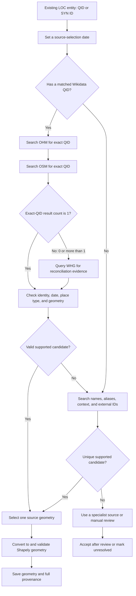

# Geocoding High-Level Process

**Synthetic LOC approval - 21 October 2026:** all existing LOC identities enter Geography, including unresolved SYN IDs. QIDs use exact-ID lookup first; SYN IDs use the existing name/alias/date/type/context fallback and keep their original IDs. Supported geometry does not create a Wikidata match. Ambiguous candidates remain unresolved. `Geography.geometry_ref.place_id` can therefore be an existing QID or SYN ID; the reference stays in the model, not graph JSON. This extends target coverage under the existing source and acceptance policy.

**Geometry pointer correction - 21 October 2026:** `Geography.geometry_ref` belongs to the data model, not final graph JSON. It retains the approved `{file, place_id, sha256}` format and identifies the saved Shapely/WKB object. The existing loader can read this model reference; Agent access to the model still requires integration verification. Earlier graph-node pointer instructions are superseded. No pointer or inline GeoJSON is exported in graph JSON.

## Purpose

This process seeks one supported geographic object for each existing LOC entity, including synthetic identities without a Wikidata match. The result is designed for model population and Agent testing. Insufficient identity evidence leaves geometry unresolved.

Policy version: `geo-object-selection-v0.5.0`

Approved population extension, 21 October 2026: include synthetic LOC identities in the existing name/alias/date/type/context fallback. Keep each original SYN ID; do not assign a new QID or merge repeated names. This changes target coverage, not the source list or acceptance rules.

Bulk acquisition plan added: `2026-10-19`. This is a planned retrieval method;
the place-selection rules remain unchanged.

## Final data model

- The existing entity ID identifies the place: its QID when matched, otherwise its unchanged SYN ID. A geometry match does not change the entity's Wikidata matching status.
- Each place entity has one selected geographic object.
- The geographic object is stored as a Shapely geometry.
- Geocoding returns a validated Shapely object, not GeoJSON. GeoParquet persists it as WKB and restores it as Shapely when loaded. The Geography data model contains `geometry_ref={file,place_id,sha256}` pointing to the saved object. The loader restores Shapely from this model reference. Final graph JSON omits the pointer and inline geometry. Agent access to the model must be verified, as defined in the [S2T](ENTITY_MODEL_TO_AGENT_GRAPH_S2T.md#geometry-object-reference-and-loading).
- The geometry can represent a point, line, polygon, or multipolygon. Its type comes from the Shapely object, so a separate geometry-type field is not required.
- The place-to-geometry connection has no `valid_from` or `valid_to` fields.
- Wikidata coordinates and shapes are not used as geometry sources.
- Wikidata names, aliases, types, parent context, QIDs, and external identifiers can be used as identity evidence.
- The coordinate reference system must be stored in the geometry table metadata. The Agent contract does not yet define its required CRS.

## Process overview

## Selection date

The source-selection period is the Pacific War period: **1941-12-07 through 1945-09-02**, inclusive.

For each place:

1. Use the earliest related event or relation date inside this period.
2. If no related date exists, use `1941-12-07`.
3. If several dates exist, use the earliest date inside the period.

**Partial-date approval - 21 October 2026:** retain year/month precision (`YYYY` or `YYYY-MM`) and compare the source date range at that same precision. Do not insert day 01 or invent an exact date. Project-period eligibility uses the existing possible-overlap comparison at the supplied precision. Preserve the original date evidence.

The date helps select a historical source object. It is kept in the audit record and is not an attribute of the final place-to-geometry link.

A dated source geometry is eligible when its source interval contains the selection date. An undated geometry remains eligible when its identity and place meaning are correct.

## Source order and rationale

| Order | Source or method | Use | Rationale |
|---:|---|---|---|
| 1 | OpenHistoricalMap (OHM) | Find an exact `wikidata=QID` object and check its source dates. | Historical objects can better represent a WWII place or boundary. |
| 2 | OpenStreetMap (OSM) | Find an exact `wikidata=QID` object, mainly for stable physical features and current boundaries. | OSM has broad geometry coverage and often supplies a usable object when OHM does not. |
| 3 | World Historical Gazetteer (WHG) | Query only when the combined OHM and OSM exact-QID count is zero or greater than one. Use it for reconciliation and linked-source evidence. | WHG can resolve missing or ambiguous identities, but its request quota is limited and a WHG union is not a final geometry. |
| 4 | Name, alias, and context search | Search OHM or OSM name services and GeoNames. Require added evidence such as a source ID, compatible type and parent area, or two airport codes. | This recovers places without an exact QID link while controlling false matches from shared names. |
| 5 | Specialist source or documented manual construction | Use a suitable public dataset or digitize a documented historical map. | Some historical places have no supported object in the general sources. |

WHG requests are batched, with up to 50 place queries in one API request. The WHG key stays in the local `.env` file and must not appear in outputs or logs.

## Bulk downloads and reuse

Use saved snapshots and bulk exports as the main retrieval method. Search them
for all existing LOC targets after entity matching, using QID lookup where available and the supported name/context fallback otherwise, rather than making
the same request for every mention. Retain all candidate objects for the
existing identity, date, type, and geometry checks. Source priority remains
OHM, then OSM, with WHG used under the exact-QID count rule above.

| Data | Bulk retrieval plan |
|---|---|
| Wikidata identity evidence | Reuse the saved BigQuery reference results first. Retrieve missing QIDs together from BigQuery, or use an [official Wikidata dump](https://www.wikidata.org/wiki/Wikidata:Database_download). Wikidata remains an identity source only. |
| OHM geometries and tags | Download a pinned [OHM snapshot](https://wiki.openstreetmap.org/wiki/OpenHistoricalMap/Reuse) and search locally for QIDs and supported fallback evidence. |
| OSM geometries and tags | Export candidates for the place-QID list from the [OSM BigQuery dataset](https://wiki.openstreetmap.org/wiki/BigQuery_dataset). [Geofabrik regional files](https://www.geofabrik.de/en/data/download.html) are an alternative when required objects or complete geometry are unavailable in that dataset. |
| GeoNames fallback records | Reuse or download the needed [country files](https://download.geonames.org/export/dump/readme.txt) and search them locally using the existing identity-evidence rules. |

**OSM snapshot decision — 19 October 2026:** The user accepts the older OSM
BigQuery snapshot for this historical-period project. Snapshot age is not a
rejection criterion, and updating it to the latest OSM data is not required.
Still record the snapshot date. Historical suitability is assessed separately:
each candidate must pass the existing place-identity, geographic-meaning, and
selection-date rules. The snapshot's publication date does not establish that
its shapes represent the WWII period.

The planned sequence is:

1. Produce targets for all existing LOC identities, retaining original mention
   and page references. QIDs use exact-ID lookup first; synthetic IDs use the
   existing name/alias/context fallback directly. Never send a SYN ID as a QID.
   Retain each synthetic target separately; no new entity extraction or merging.
2. Reuse saved references and retrieve missing candidates in bulk. For BigQuery,
   estimate bytes processed before execution and save the query and result.
3. Apply the existing selection policy to each place; preserve rejected
   candidates and unresolved reasons.
4. Save one selected Shapely geometry per accepted place, with reusable
   GeoParquet output and provenance.
5. Use controlled, cached API calls only for remaining gaps or necessary WHG
   reconciliation. Keep resumable checkpoints and respect each service's limits.

For each input snapshot or bulk export, save the source URL or table ID,
available source date/version, retrieval time, query or filter scope, row count,
and file checksum. Reuse verified saved files on restart. This plan does not
start a new download, geocoding run, or Agent release.

## Automatic candidate logic

For each place, the process:

1. Collects the OHM and OSM candidates.
2. Uses the Wikidata QID as the strongest identity link when available; otherwise uses supported name/alias/type/context evidence. Daniel's source-page title is context, not proof of a parent area. Missing type/parent evidence is not invented. Dates use the existing rule, including its default when unsupported.
3. Uses WHG only under the rule above.
4. Removes candidates that do not apply on the selection date.
5. Removes candidates whose geographic meaning conflicts with the place type.
6. Applies the preferred representation for the place type.
7. Selects the first valid candidate in the project period. A stable source object ID breaks a remaining tie.
8. Retrieves the full geometry. If it is missing or invalid, the process tries the next source.
9. Converts the selected geometry to Shapely and checks that it is valid and not empty.
10. Saves the choice, source, evidence, rejected alternatives, and decision reason.

The process does not automatically union, buffer, simplify, or replace a geometry with its centroid. Each such transformation needs an explicit rule and an audit record.

## Place type and preferred geometry

| Place type | Preferred representation | Allowed fallback |
|---|---|---|
| Country or administrative area | Administrative boundary | Exact-identity point |
| City or settlement | Administrative boundary | Settlement point |
| Island | Land extent | Exact-identity point |
| Atoll | Reef extent | Reviewed island or regional extent |
| Harbor | Harbor or water extent | Exact-identity point |
| Airfield, base, camp, or facility | Site footprint | Exact-identity point |
| River, route, or other linear place | Line geometry | Exact-identity point |

These rules select the geographic meaning. They do not change the entity identity.

## Decision outcomes

- `ACCEPTED_AUTO`: deterministic identity, date, type, and geometry checks pass.
- `ACCEPTED_REVIEWED`: a reviewer accepts a candidate and records the reason.
- `UNRESOLVED`: the available evidence is insufficient.
- `REJECTED_NOT_PLACE`: the upstream node is not a place and must not receive a geometry.

An uncertain place stays unresolved. It does not receive a guessed geometry.

## Output and audit requirements

The main geometry table needs these fields:

| Field | Meaning |
|---|---|
| `place_id` | Existing LOC entity ID: QID or unchanged SYN ID |
| `name` | Place label used in the run |
| `place_type` | Normalized place class |
| `geometry` | Selected Shapely object |
| `source_dataset` | Selected source |
| `source_object_id` | Source record identifier |
| `source_url` | Direct source record URL |
| `match_method` | Exact QID, reconciled ID, or reviewed contextual match |
| `selection_date` | Date used to select the source geometry |
| `selection_policy_version` | Version of this process |
| `retrieved_at` | Retrieval timestamp |
| `review_status` | Decision outcome |
| `decision_reason` | Short evidence-based explanation |

The audit data also keeps all candidates, source attempts, exact-QID counts, WHG query details, rejected candidates, validation results, and review decisions. GeoParquet is the working storage format because it restores the geometry as a Shapely object when loaded.

## Why this design is used

- A QID gives all sources one identity anchor.
- Historical sources have priority because a WWII geometry can differ from a current map.
- Place type prevents the system from choosing the wrong meaning of a shared QID, such as a point instead of an atoll extent.
- Context fields reduce false matches when no source has an exact QID link.
- One geometry per place gives the Agent a simple and stable interface.
- Full provenance permits later review, correction, and replacement.
- An unresolved result is safer than a geometry selected from weak evidence.

## Current proof of concept

The first 50 nodes classified as locations produced:

- 47 accepted Shapely geometries.
- 34 objects from OSM, 9 from OHM, and 4 from GeoNames.
- 24 points, 20 polygons, and 3 multipolygons.
- 0 unresolved valid place inputs.
- 3 inputs rejected as non-places.

The four GeoNames results are points. They are usable starting geometries and can be replaced by better supported shapes in a later policy version.

## Production limits

- The model pointer schema and geometry loading helper exist. Agent access to Geography, storage/version binding and spatial CRS compatibility remain integration checks. Graph JSON does not carry a geometry pointer or inline GeoJSON.
- Bulk exports and saved snapshots are the planned main retrieval route. Public query services used for gaps can time out or limit requests; use controlled retries, persistent caches, and resumable checkpoints.
- Source coverage does not prove geographic truth. Candidate evidence and provenance must remain available for quality review.
